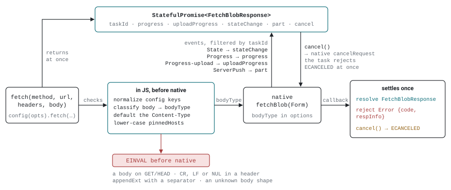
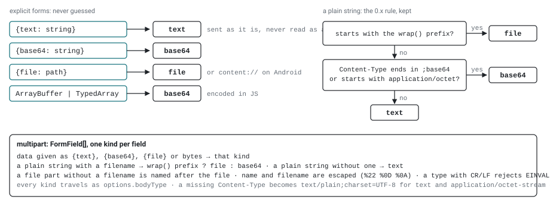

# Requests

`fetch` sends an HTTP request from native code; `config(options)` returns a `fetch` with options
bound to it. The response is held in memory or written straight to a file, so large bodies never
pass through JavaScript.

## fetch

```ts
fetch(method: Methods, url: string, headers?: RequestHeaders, body?: RequestBody): StatefulPromise<FetchBlobResponse>
```

| Argument | |
|---|---|
| `method` | `GET`, `POST`, `PUT`, `PATCH`, `DELETE`, `HEAD`, `OPTIONS`, in any case |
| `url` | the request URL |
| `headers` | header names and values; `null` and `undefined` values are sent as `""` |
| `body` | see [Request bodies](#request-bodies) |

Resolves a [response](responses.md). An HTTP error status (404, 500, ...) resolves like any other
response; check `res.ok` or `res.status`. The promise rejects only when the request itself fails:
no connection, a timeout, a TLS error, a cancel. See [errors.md](errors.md).

The returned task also reports [progress, can be cancelled](progress-and-cancel.md) and, for a
download to a file, [paused and resumed](downloads.md).

```js
import {fetch} from 'react-native-blob-util';

async function loadItems() {
    try {
        const res = await fetch('GET', 'https://example.com/api/items', {
            Authorization: 'Bearer access-token',
        });
        if (!res.ok) {
            console.warn('Server answered', res.status);
            return null;
        }
        return await res.json();
    } catch (err) {
        // the request failed: no connection, timeout, TLS error, cancelled ...
        console.warn(err.code, err.message);
        return null;
    }
}
```

Cookies set by other requests in the app are sent along.

## How a request runs

Everything that can be decided without the network is decided in JavaScript before native code
is involved, so the three platforms cannot disagree about it.



1. `fetch` returns a task at once: a Promise with `taskId`, `progress`, `uploadProgress`,
   `stateChange`, `part`, `cancel`, `pause` and `resume` on it.
2. The options are checked, the body is classified as text, base64, a file or a multipart form
   (see [below](#request-bodies)), and a missing `Content-Type` is filled in.
3. A request that cannot be valid rejects `EINVAL` here, before anything reaches native: a body
   on `GET` or `HEAD`, a header with CR, LF or NUL, an `appendExt` with a path separator, options
   that do not go together.
4. Native sends the request and reports its progress as events, which reach the handlers
   registered on the task.
5. The task settles once: it resolves a [response](responses.md), or rejects an error whose
   `code` names the failure ([errors.md](errors.md)). Everything the task registered is removed
   then, so a finished task leaves nothing behind.

## config

```ts
config(options: ReactNativeBlobUtilConfig): {fetch}
```

```js
import {config} from 'react-native-blob-util';

const res = await config({fileCache: true, timeout: 30000}).fetch('GET', url);
```

| Option | Type | Description |
|---|---|---|
| `fileCache` | `boolean` | Write the response to a file with a random name in the cache directory. |
| `appendExt` | `string` | Extension of the `fileCache` file name, e.g. `png` or `tar.gz`. A value with `/`, `\`, `:` or a control character rejects `EINVAL`. |
| `path` | `string` | Write the response to this path. Overrides `fileCache` and `appendExt`. |
| `overwrite` | `boolean` | Replace an existing file at `path` (default `true`); `false` appends the response to it. |
| `resumable` | `boolean` | Download through a part file that a later request continues. See [downloads.md](downloads.md#resumable-downloads). |
| `background` | `boolean \| {id}` | Let the system run the download, so it outlives the app. See [downloads.md](downloads.md#downloads-that-outlive-the-app). |
| `key` | `string` | Cache the response under this key: a file downloaded with the same key is returned without a request. Only a response that arrived whole with a success status is kept; after an error status or an interrupted download the next request asks the server again. |
| `session` | `string` | Add the response file to this [session](responses.md#sessions). |
| `timeout` | `number` | Request timeout in milliseconds. Default 60000. |
| `followRedirect` | `boolean` | Follow redirects (default `true`). An `Authorization` header goes along only within the same scheme, host and port on Android and Windows; iOS drops it on every redirect. |
| `transform` | `boolean` | Run the [file transformer](file-transformer.md) on a response written to a file. |
| `trusty` | `boolean` | Skip certificate validation; development only. See [below](#self-signed-certificates). |
| `customCACerts` | `string[]` | Trust these bundled CA certificates. See [below](#custom-ca-certificates). |
| `pinnedHosts` | `string[]` | Apply `customCACerts` to these hosts only. |
| `trustSystemCerts` | `boolean` | Keep trusting the system's CAs alongside `customCACerts`. Default `false`. |
| `auto` | `boolean` | Write a binary response to a cache file, as `fileCache` does, and keep text and JSON in memory. Binary is any Content-Type but `text/*` and `application/json`, or one in `binaryContentTypes`. Android and iOS. |
| `binaryContentTypes` | `string[]` | Content-Type fragments that count as binary. |
| `android.downloadManager` | object | Download through Android's DownloadManager. See [android.md](android.md#downloadmanager). |
| `android.wifiOnly` | `boolean` | Send the request over WiFi only; `ENETUNREACH` without WiFi. |
| `android.targetHostIp` | `string` | Send the request over the network interface that can reach this IP. |
| `ios.backgroundTask` | `boolean` | Run the download in the iOS background session. See [ios.md](ios.md#background-transfers). |

Options for one platform are ignored on the others.

## Request bodies

Say what a body is with an explicit form; it is never guessed:



| Body | Sent as |
|---|---|
| `{text: string}` | the string, as it is |
| `{base64: string}` | the bytes the base64 string encodes |
| `{file: path}` | the contents of a file: a path, a `file://` URL, or a `content://` URI on Android |
| an `ArrayBuffer` or a typed array (`Uint8Array`, ...) | the bytes |
| an array of fields | a [multipart form](#multipart-forms) |

```js
import {fetch, fs} from 'react-native-blob-util';

// JSON, or any string that comes from a user or a server
await fetch('POST', 'https://example.com/api/notes', {
    'Content-Type': 'application/json',
}, {text: JSON.stringify({title: 'Hello'})});

// binary data held as base64
await fetch('POST', 'https://example.com/api/upload', {
    'Content-Type': 'application/octet-stream',
}, {base64: imageBase64});

// a file, streamed from storage
await fetch('PUT', 'https://example.com/upload/video.mp4', {
    'Content-Type': 'video/mp4',
}, {file: fs.dirs.DocumentDir + '/video.mp4'});

// bytes
await fetch('POST', 'https://example.com/api/blob', {
    'Content-Type': 'application/octet-stream',
}, new Uint8Array([0x89, 0x50, 0x4e, 0x47]));
```

A **plain string** body is read by an older rule, the same way on every platform:

- a string made by `wrap(path)` is a file (`wrap` works for paths and `content://` URIs);
- with a `Content-Type` that ends in `;base64` (removed before sending) or starts with
  `application/octet`, the string is base64;
- anything else is text, and so is a string without a `Content-Type`.

Prefer `{text}` for a string you did not write yourself: a plain string that happens to start with
the file prefix is uploaded as that file's contents.

Rules every platform applies before sending:

- `GET` and `HEAD` reject a body with `EINVAL`; every other method sends it.
- A file body that cannot be read fails the request before anything is sent: `ENOENT` when the
  file is not there, `EISDIR` for a directory, `EACCES` when the app may not read it. A readable
  empty file is sent as an empty body.
- A header name or value containing CR, LF or NUL rejects with `EINVAL`.

## Multipart forms

Pass an array of fields as the body; the library sets `Content-Type: multipart/form-data` with
its boundary. Each field has a `name` and `data`, and optionally a `filename` and a `type` (the
part's MIME type). `data` takes the explicit forms above; a plain string is text in a field without
a `filename`, and base64 (or a `wrap(path)` file) in one with a `filename`. A file part without a
`filename` is named after the file.

```js
import {fetch, fs, wrap} from 'react-native-blob-util';

const res = await fetch('POST', 'https://example.com/upload-form', {
    Authorization: 'Bearer access-token',
    'Content-Type': 'multipart/form-data',
}, [
    {name: 'name', data: 'user'},
    {name: 'info', data: {text: JSON.stringify({mail: 'example@example.com'})}},
    {name: 'avatar', filename: 'avatar.png', type: 'image/png', data: {file: fs.dirs.DocumentDir + '/avatar.png'}},
    {name: 'ringtone', filename: 'ring.mp3', type: 'audio/mpeg', data: wrap(fs.asset('default-ringtone.mp3'))},
    {name: 'thumbnail', filename: 'thumb.jpg', type: 'image/jpeg', data: {base64: thumbnailBase64}},
]);
```

A file part that cannot be read fails the request, as a file body does. A `name` or `filename`
containing `"`, CR or LF is escaped the way browsers do (`%22`, `%0D`, `%0A`); a `type` containing
CR or LF rejects with `EINVAL`.

## Transfer encoding and caching

Chunked transfer encoding is off by default, since some servers do not support it. To use it, set
the header: `{'Transfer-Encoding': 'Chunked'}`. Requests use the HTTP cache; to bypass it, send
`'Cache-Control': 'no-store'`.

## Self-signed certificates

By default a server whose certificate does not chain to a trusted CA is refused (`ESSL`).
`trusty: true` skips that check. It is for development against a test server; to trust a private
CA in production use [custom CA certificates](#custom-ca-certificates).

What `trusty` skips differs per platform:

- **Android** uses the `X509TrustManager` your app sets as
  `ReactNativeBlobUtilUtils.sharedTrustManager`; the library ships none, and a `trusty` request
  fails without one. The host name is still verified.
- **iOS** accepts the server's certificate whatever issued it; a certificate for another host name
  or an expired one still fails.
- **Windows** ignores an untrusted chain; a certificate for another host name or an expired one
  still fails.

```kotlin
// MainApplication.kt
import com.ReactNativeBlobUtil.ReactNativeBlobUtilUtils
import java.security.cert.X509Certificate
import javax.net.ssl.X509TrustManager

class MainApplication : Application(), ReactApplication {
    override fun onCreate() {
        super.onCreate()
        ReactNativeBlobUtilUtils.sharedTrustManager = object : X509TrustManager {
            override fun checkClientTrusted(chain: Array<X509Certificate>, authType: String) {}
            override fun checkServerTrusted(chain: Array<X509Certificate>, authType: String) {}
            override fun getAcceptedIssuers(): Array<X509Certificate> = arrayOf()
        }
    }
}
```

```js
const res = await config({trusty: true}).fetch('GET', 'https://mysite.test');
```

## Custom CA certificates

Trust a specific certificate authority (an internal CA, a self-signed CA for devices, a private
PKI) for a request, without switching validation off.

**Bundling the certificate**

- Expo: list it in the [config plugin](installation.md#expo).
- iOS: add the file to the Xcode project's "Copy Bundle Resources" phase.
- Android: put it in `android/app/src/main/res/raw/` (lower case and underscores; DER without an
  extension, or `.pem`/`.cer`).
- Windows: add it to the app package so it ships next to the executable (`MainBundleDir`).

```js
import {config} from 'react-native-blob-util';

const res = await config({
    customCACerts: ['my_root_ca'],                  // resource names without extension
    pinnedHosts: ['10.10.10.10', 'gateway.local'],  // optional: only these hosts
    trustSystemCerts: false,                        // optional: also trust the system's CAs
}).fetch('GET', 'https://10.10.10.10/api/data');
```

| Option | Default | |
|---|---|---|
| `customCACerts` | | certificate resource names, `.cer`, `.der` or `.pem` |
| `pinnedHosts` | all hosts | the hosts the custom trust applies to; others use the system's trust |
| `trustSystemCerts` | `false` | trust the system's CAs as well |

The same rules apply on every platform:

- **Host name verification still applies.** A custom CA changes which issuers are trusted, not
  which names a certificate is valid for. Connecting to an IP address needs an IP SAN.
- **A certificate that cannot be loaded fails the request**, rather than falling back to the
  system's trust, so a typo cannot undo the pinning.
- **`pinnedHosts` scopes the trust**, decided per connection, so a redirect to or from a pinned
  host is covered. Host names are compared case-insensitively.

A rejected certificate fails the request with `ESSL`. For trust that applies to every HTTP client
in an Android app, Android's
[Network Security Configuration](https://developer.android.com/training/articles/security-config)
is the declarative alternative.
