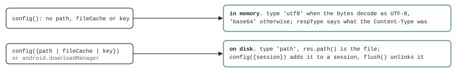

# Responses

What a request resolves: the status, the headers, and the body, held in memory or written to a
file. And how to manage the files downloads leave behind.

## The response



| Member | What it is |
|---|---|
| `res.status` | the HTTP status |
| `res.ok` | `true` for a status of 200..299 |
| `res.headers` | the response headers, names in lower case |
| `res.url` | the URL the body came from, after redirects; `undefined` when unknown |
| `res.info()` | the full response info: `status`, `headers`, `redirects`, `respType`, ... |
| `res.text()` | the body as text (UTF-8) |
| `res.json()` | the body parsed as JSON |
| `res.base64()` | the body as a base64 string |
| `res.array()` | the body as byte values 0..255 |
| `res.arrayBuffer()` | the body as an `ArrayBuffer` |
| `res.path()` | the path of the response file, or `null` when the body is in memory |
| `res.flush()` | removes the response file; resolves at once when there is none |
| `res.readFile(encoding)` | reads the response file; rejects `EINVAL` when the body is not a file |
| `res.readStream(encoding)` | a [read stream](streams.md) over the response file; rejects `EINVAL` when the body is not a file |
| `res.session(name)` | adds the response file to a [session](#sessions); throws `EINVAL` when the body is not a file |
| `res.taskId`, `res.type`, `res.data`, `res.respInfo` | the task's id, the body's form (`utf8`, `base64` or `path`), the body, the response info |

`text()`, `json()`, `base64()`, `array()`, `arrayBuffer()` and `flush()` always return a Promise,
whether the body is in memory or in a file.

A body held in memory is kept as `utf8` when its bytes decode as UTF-8 and as `base64` otherwise;
`res.type` says which. The request header `RNFB-Response: 'base64' | 'utf8'` forces one form; the
library reads it and does not send it.

## Downloading to a file

A large response should not pass through JavaScript. With `fileCache: true` it is written to a
file with a random name in the cache directory (`appendExt` gives it an extension); with `path` it
is written where you say.

```js
import {config, fs} from 'react-native-blob-util';

const res = await config({
    path: fs.dirs.DocumentDir + '/report.pdf',
}).fetch('GET', 'https://example.com/report.pdf', {
    Authorization: 'Bearer access-token',
});

if (!res.ok) {
    // the error page was written to the file; don't keep it
    await res.flush();
    throw new Error(`Download failed with status ${res.status}`);
}
console.log('Saved to', res.path());
```

Check `res.ok` before using a downloaded file: an error status still resolves, and the file then
holds the server's error body. The parent directories of `path` are created.

```js
import {Image} from 'react-native';
import {config} from 'react-native-blob-util';

const res = await config({fileCache: true, appendExt: 'png'})
    .fetch('GET', 'https://example.com/image.png');

// an Image source needs the file:// prefix on Android; iOS accepts it as well
const image = <Image source={{uri: 'file://' + res.path()}} />;
```

With `transform: true` the registered [file transformer](file-transformer.md) runs on the response
before it is written (to encrypt it, say). It only applies to a response written to a file.

For downloads that pause, continue after a failure, or outlive the app, see
[downloads.md](downloads.md).

## Cleaning up

Files written by `fileCache` or `path` stay until you remove them:

```js
const res = await config({fileCache: true}).fetch('GET', 'https://example.com/file');
// ... use the file, then
await res.flush();
// or, by path
await fs.unlink(somePath);
```

## Sessions

A session is a named list of files that are removed together. Sessions live in JavaScript memory
and do not survive an app restart.

```js
import {config, session} from 'react-native-blob-util';

// add the response file when the request completes
await config({fileCache: true, session: 'foo'}).fetch('GET', 'https://example.com/a');

// or afterwards
const res = await config({fileCache: true}).fetch('GET', 'https://example.com/b');
res.session('foo');

// or any file
session('foo').add(someFilePath);
session('foo').remove(someFilePath);
console.log(session('foo').list());

// delete every file in the session and forget it
await session('foo').dispose();
```

`fs.session(name)` is the same as `session(name)`.
