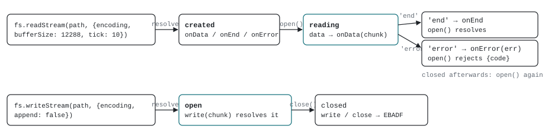

# Streams

Read and write a file in chunks, for files too large to hold in memory at once.



## readStream

```ts
fs.readStream(path, encoding?, bufferSize?, tick?): Promise<ReactNativeBlobUtilReadStream>
fs.readStream(path, {encoding?, bufferSize?, tick?}): Promise<ReactNativeBlobUtilReadStream>
```

| Option | Default | |
|---|---|---|
| `encoding` | `utf8` | `utf8`, `base64` or `ascii` |
| `bufferSize` | 12288 | bytes per chunk; use a multiple of 3 for `base64` |
| `tick` | 10 | milliseconds between chunks |

Register the handlers, then call `open()`. `open()` returns a Promise that resolves when the stream
reaches the end of the file and rejects with the error when it fails.

```js
import {fs} from 'react-native-blob-util';

const stream = await fs.readStream(pathToFile, {encoding: 'base64', bufferSize: 12288});

let data = '';
stream.onData((chunk) => {
    // a string, or an array of bytes 0..255 for 'ascii'
    data += chunk;
});
stream.onEnd(() => console.log('read', data.length, 'characters'));

try {
    await stream.open();
} catch (err) {
    console.warn('read failed', err.code, err.message);
}
```

If you do not await `open()`, set `onError`: with it set, a failure does not become an unhandled
rejection.

```js
stream.onError((err) => console.warn(err.code, err.message));
stream.open();
```

A stream opens once; opening a finished stream rejects `EBADF`. The path can be a file, a
`file://` URL, an asset, and on Android a resource or a content URI.

## writeStream

```ts
fs.writeStream(path, encoding?, append?): Promise<ReactNativeBlobUtilWriteStream>
fs.writeStream(path, {encoding?, append?}): Promise<ReactNativeBlobUtilWriteStream>
```

`write(data)` resolves the stream, so writes chain; `close()` ends it. A write stream must be
closed.

```js
import {fs} from 'react-native-blob-util';

const out = await fs.writeStream(pathToFile, {encoding: 'utf8', append: true});
try {
    await out.write('foo');
    await out.write('bar');
} finally {
    await out.close();
}
```

Wait for each `write()`: a write whose Promise nobody waits for can fail unnoticed. Writing to or
closing a closed stream rejects `EBADF`. For an `ascii` stream, write arrays of bytes.

## Performance

Each chunk is one event to JavaScript. If a large file keeps the JS thread busy, use a larger
`bufferSize` (a multiple of 3 for base64, such as 102399) and a larger `tick`. To read only part of
a file, [`fs.read`](file-system.md#read-write-part-of-a-file) is simpler than a stream.
